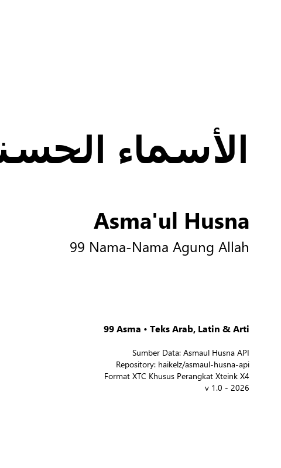
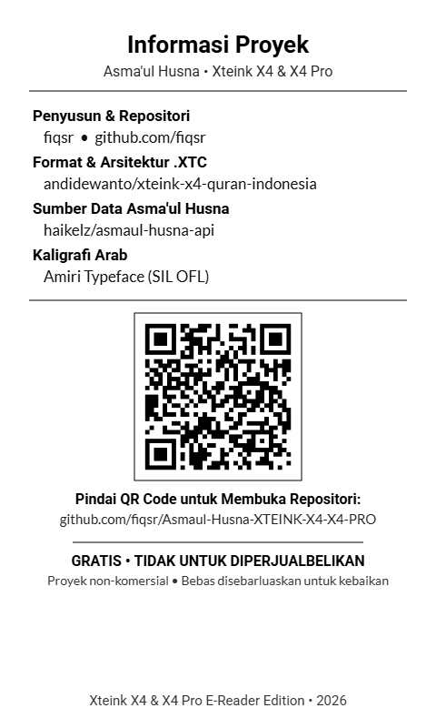
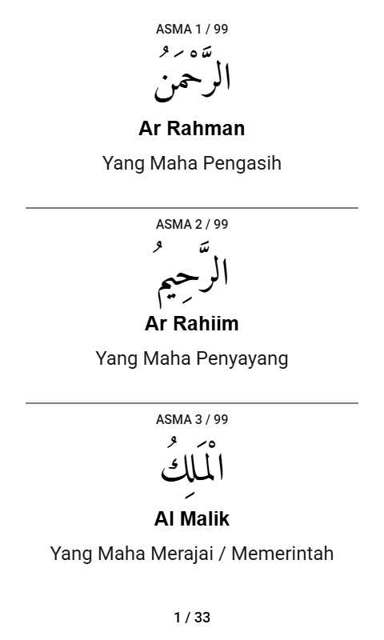
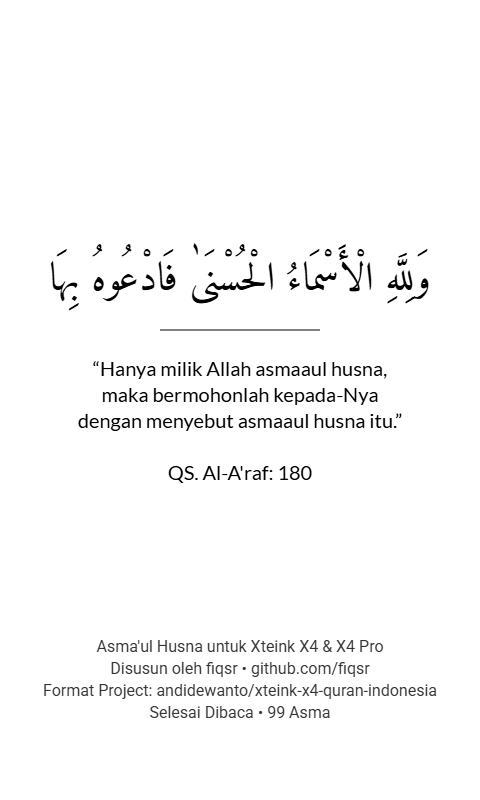

# Asma'ul Husna untuk Xteink X4 & X4 Pro

[](https://github.com/fiqsr/Asmaul-Husna-XTEINK-X4-X4-PRO/releases/latest)
[-blue?logo=github)](https://github.com/fiqsr/Asmaul-Husna-XTEINK-X4-X4-PRO/releases/download/v1.0.0/Asmaul-Husna.xtc)
[](https://github.com/fiqsr/Asmaul-Husna-XTEINK-X4-X4-PRO/releases/download/v1.0.0/Asmaul_Husna_XTEINK_X4.epub)

Koleksi lengkap **99 Asma'ul Husna dalam format `.xtc` dan `.epub`** yang disiapkan khusus untuk dibaca pada perangkat e-reader / e-paper saku **Xteink X4 & Xteink X4 Pro** (resolusi 480 × 800 piksel).

Disusun dan dikembangkan oleh **fiqsr** ([github.com/fiqsr/Asmaul-Husna-XTEINK-X4-X4-PRO](https://github.com/fiqsr/Asmaul-Husna-XTEINK-X4-X4-PRO)).

---

## Pratinjau Tampilan (Resolusi Asli 480 × 800 px)

| Sampul Minimalis | Informasi & QR Code | Halaman Isi (Grid Tetap) | Halaman Penutup |
| :---: | :---: | :---: | :---: |
|  |  |  |  |

---

## Fitur Utama

1. **Tata Letak Khusus Layar E-Ink 4.3"**:
   - Didesain pas dengan resolusi fisik 480 × 800 px.
   - Kontras murni hitam-putih 1-bit tanpa gradasi abu-abu pudar.
   - **Sistem Grid Tetap (*Fixed Grid*)**: Posisi nomor, kaligrafi Arab, nama Latin, dan terjemahan terkunci konsisten tanpa getaran/lonjakan vertikal saat membalik halaman.
2. **Kelengkapan Teks**:
   - 100% lengkap dengan **harakat/tasykil** resmi.
   - Menggunakan kaligrafi Arab **Amiri Font** yang elegan dan mudah dibaca di layar e-paper.
   - Nomor urut (Asma 1 s/d 99).
   - Transliterasi Latin resmi.
   - Terjemahan makna bahasa Indonesia dengan pembagian baris rapi tanpa pemotongan teks (*no truncation*).
3. **Format Ganda**:
   - **Format `.xtc`**: Format native komik/buku Xteink X4 dengan pemuatan halaman instan (terletak di folder `xtc/Asmaul-Husna.xtc`).
   - **Format `.epub`**: Standar EPUB 2/3 dengan font Arab Amiri tertanam dan navigasi bab (terletak di folder `epub/Asmaul_Husna_XTEINK_X4.epub`).
4. **Halaman Informasi & QR Code**:
   - Dilengkapi halaman pengantar dengan QR Code yang langsung mengarah ke repositori resmi untuk kemudahan berbagi antar sesama pengguna Xteink.
5. **Generator Terintegrasi**:
   - Dilengkapi web generator mandiri offline (`generator/index.html`) dan skrip CLI Python (`generator/generate.py`).

---

## Struktur Proyek

```text
Asmaul-Husna-XTEINK-X4-X4-PRO/
├── docs/
│   └── preview/
│       ├── 00-sampul.png
│       ├── 01-informasi.png
│       ├── 02-halaman-01.png
│       ├── 03-halaman-73-75.png
│       ├── 04-penutup.png
│       └── repo_qrcode.png
├── generator/
│   ├── index.html        # Web Generator interaktif dengan canvas preview & export
│   ├── generate.py       # Compiler CLI berbasis Python
│   ├── asmaul_husna.json # Dataset 99 Asma'ul Husna berharakat
│   └── Amiri-Regular.ttf # Font Arab Amiri
├── xtc/
│   ├── README.md
│   └── Asmaul-Husna.xtc  # Berkas biner XTC 36 halaman siap pakai
├── epub/
│   └── Asmaul_Husna_XTEINK_X4.epub # Berkas EPUB siap pakai
├── push.bat              # Skrip sekali-klik push ke GitHub
├── ATTRIBUTION.md
├── LICENSE.md
└── README.md
```

---

## Cara Menggunakan pada Xteink X4 & X4 Pro

1. Unduh berkas **`xtc/Asmaul-Husna.xtc`**.
2. Sambungkan perangkat Xteink X4 / X4 Pro ke komputer via kabel USB atau masukkan kartu microSD.
3. Salin file `Asmaul-Husna.xtc` ke dalam penyimpanan perangkat.
4. Buka berkas melalui menu pembaca bawaan perangkat.

---

## Atribusi & Sumber Data

- **Penyusun & Desain:** [fiqsr](https://github.com/fiqsr)
- **Repositori Proyek:** [Asmaul-Husna-XTEINK-X4-X4-PRO](https://github.com/fiqsr/Asmaul-Husna-XTEINK-X4-X4-PRO)
- **API Data Asma'ul Husna:** [haikelz/asmaul-husna-api](https://github.com/haikelz/asmaul-husna-api) oleh Haikel.
- **Teks Arab & Harakat:** [adiman-dev/islamic-json](https://github.com/adiman-dev/islamic-json) oleh Adiman.
- **Format & Arsitektur .XTC:** [andidewanto/xteink-x4-quran-indonesia](https://github.com/andidewanto/xteink-x4-quran-indonesia) oleh Andi Dewanto.
- **Font Arab:** [Amiri Typeface](https://github.com/aliftype/amiri) (SIL Open Font License).
- **Lisensi Kode:** MIT License. Lihat [LICENSE.md](LICENSE.md).
