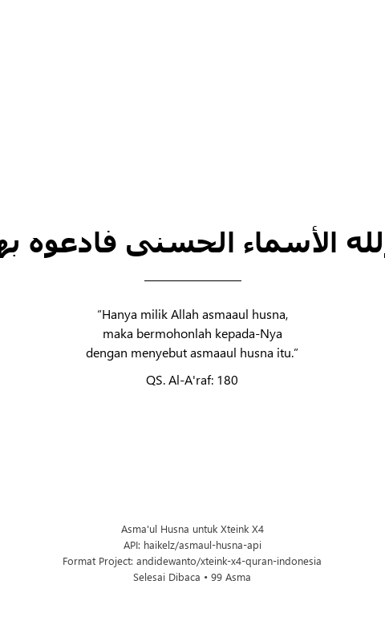

# Asma'ul Husna untuk Xteink X4

Koleksi lengkap **99 Asma'ul Husna dalam format `.xtc` dan `.epub`** yang disiapkan khusus untuk dibaca pada perangkat e-reader / e-paper saku **Xteink X4** (resolusi 480 × 800 piksel).

Proyek ini menggunakan data dari [haikelz/asmaul-husna-api](https://github.com/haikelz/asmaul-husna-api) dan mengadaptasi arsitektur format `.xtc` dari proyek [andidewanto/xteink-x4-quran-indonesia](https://github.com/andidewanto/xteink-x4-quran-indonesia) oleh Andi Dewanto.

---

## Pratinjau Tampilan (Resolusi Asli 480 × 800 px)

| Sampul Minimalis | Halaman Isi (3 Asma per Halaman) | Halaman Penutup |
| :---: | :---: | :---: |
|  |  |  |

---

## Fitur Utama

1. **Tata Letak Khusus Layar E-Ink 4.3"**:
   - Didesain pas dengan resolusi fisik 480 × 800 px.
   - Kontras murni hitam-putih 1-bit tanpa gradasi abu-abu pudar.
2. **Kelengkapan Teks**:
   - Nomor urut (Asma 1 s/d 99).
   - Teks Arab tebal, jelas, dan berharakat.
   - Transliterasi Latin resmi.
   - Terjemahan makna bahasa Indonesia.
3. **Format Ganda**:
   - **Format `.xtc`**: Format native komik/buku Xteink X4 dengan pemuatan halaman instan (terletak di folder `xtc/Asmaul-Husna.xtc`).
   - **Format `.epub`**: Standar EPUB 2/3 dengan font Arab Amiri tertanam (terletak di folder `epub/Asmaul_Husna_XTEINK_X4.epub`).
4. **Generator Terintegrasi**:
   - Dilengkapi web generator interaktif (`generator/index.html`) dan skrip CLI Python (`generator/generate.py`).

---

## Struktur Proyek

```text
xteink-x4-asmaul-husna/
├── docs/
│   └── preview/
│       ├── 00-sampul.png
│       ├── 01-halaman.png
│       ├── 02-halaman.png
│       └── 03-penutup.png
├── generator/
│   ├── index.html        # Web Generator interaktif dengan canvas preview & export
│   ├── index.php         # Entrypoint PHP kompatibel
│   ├── simpan-xtc.php    # Endpoint penyimpanan lokal
│   ├── generate.py       # Compiler CLI berbasis Python
│   ├── asmaul_husna.json # Dataset 99 Asma'ul Husna
│   └── README.md
├── xtc/
│   ├── README.md
│   └── Asmaul-Husna.xtc  # Berkas biner XTC 35 halaman siap pakai
├── epub/
│   └── Asmaul_Husna_XTEINK_X4.epub # Berkas EPUB siap pakai
├── ATTRIBUTION.md
├── LICENSE.md
└── README.md
```

---

## Cara Menggunakan pada Xteink X4

1. Ambil berkas **`xtc/Asmaul-Husna.xtc`** (atau dari folder `Downloads`).
2. Sambungkan perangkat Xteink X4 ke komputer atau masukkan microSD perangkat.
3. Salin file `Asmaul-Husna.xtc` ke dalam penyimpanan Xteink X4.
4. Buka berkas melalui menu pembaca bawaan perangkat.

---

## Atribusi & Lisensi

- **Sumber Data:** [haikelz/asmaul-husna-api](https://github.com/haikelz/asmaul-husna-api) oleh Haikel.
- **Format & Arsitektur .XTC:** [andidewanto/xteink-x4-quran-indonesia](https://github.com/andidewanto/xteink-x4-quran-indonesia) oleh Andi Dewanto.
- **Lisensi Kode:** MIT License. Lihat [LICENSE.md](LICENSE.md) dan [ATTRIBUTION.md](ATTRIBUTION.md).
